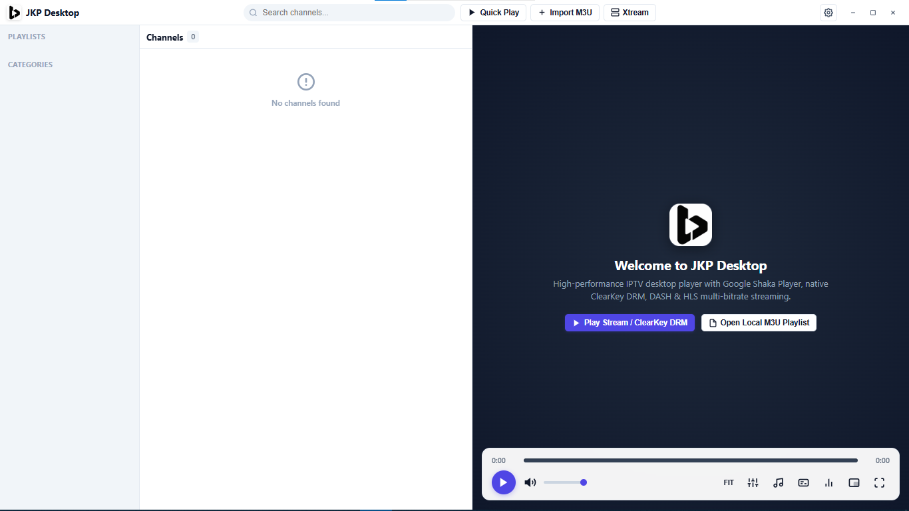
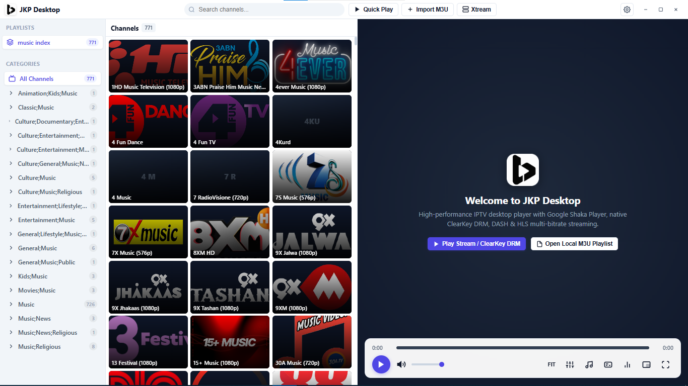
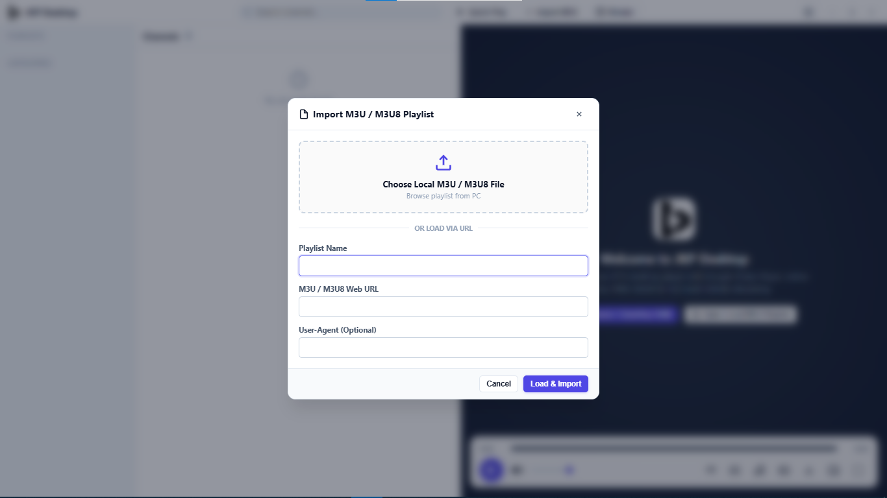
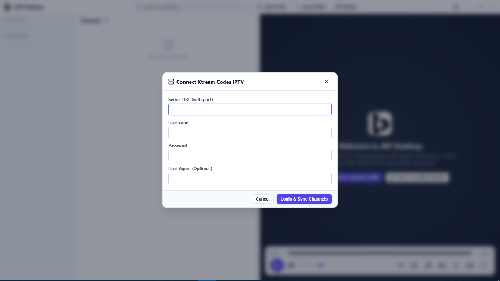
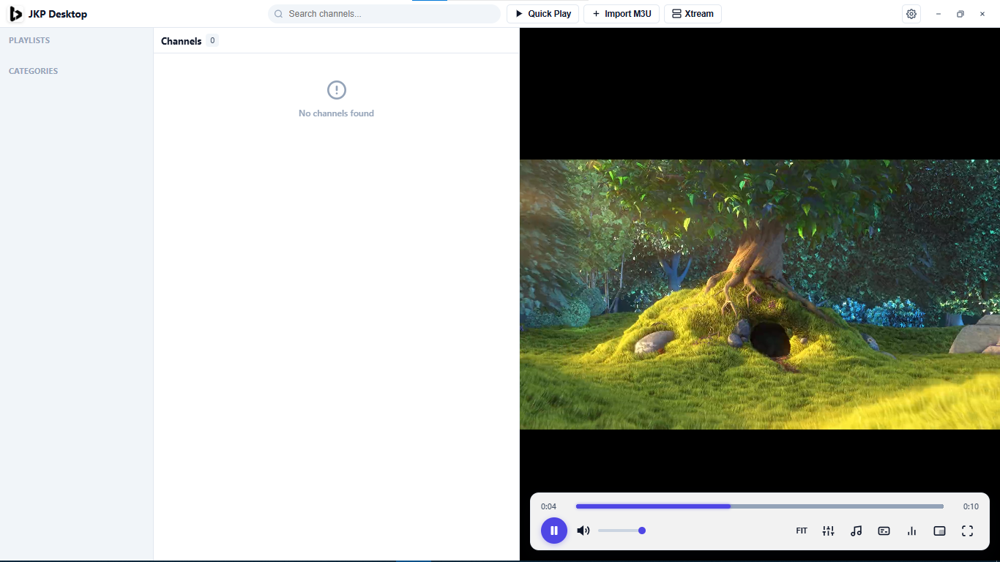
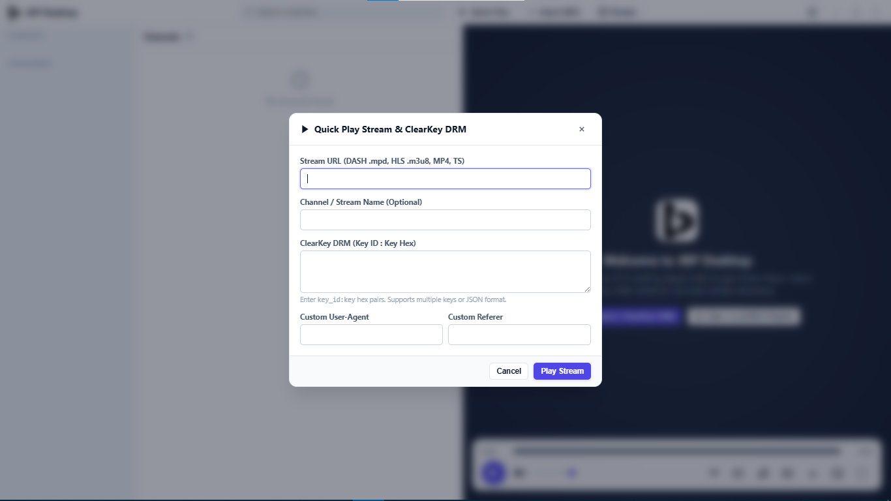
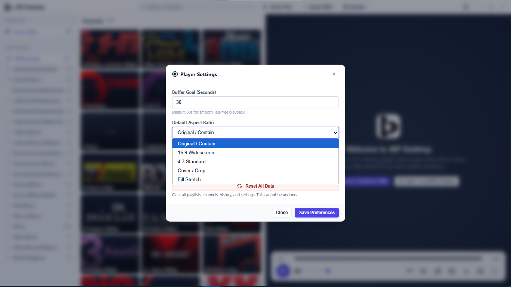

# JKP Desktop - IPTV Player

Professional IPTV player for Windows with advanced streaming capabilities.

---

## ✨ Features

### 🎬 **Video Playback**
- **Shaka Player Engine** - Industry-leading HLS & DASH support
- **4K/60fps Support** - Hardware-accelerated playback
- **DRM Support** - ClearKey and Widevine compatible
- **Adaptive Bitrate** - Automatic quality adjustment
- **Multiple Aspect Ratios** - Fit, Fill, Stretch, 16:9, 4:3
- **Picture-in-Picture** - Float player while multitasking
- **Fullscreen Mode** - Immersive viewing experience

### 📺 **IPTV Management**
- **M3U/M3U8 Support** - Import local files or remote URLs
- **Xtream Codes API** - Direct provider integration
- **Category Filtering** - Organize channels by groups
- **Search** - Fast channel search
- **Multiple Playlists** - Manage multiple sources

### 🌐 **Advanced Features**
- **Embed Stream Extraction** - Auto-extract streams from web players using Playwright
- **Custom Headers** - User-Agent, Referer, Cookies support
- **Piped URLs** - Format: `url|Header=value&embed-view=1`
- **Quick Play** - Play any stream URL directly
- **Lazy Loading** - Smooth performance with large playlists

### 🎨 **Interface**
- **Modern Light Theme** - Clean, professional design
- **3x3 Grid Layout** - Channel thumbnails
- **Compact Titlebar** - Maximize screen space

---

## 🚀 How to Use

### 1. **Import M3U Playlist**

#### From Local File:
1. Click **"Add Playlist"** button
2. Select **"Open File"**
3. Choose your `.m3u` or `.m3u8` file
4. Channels will load automatically

#### From URL:
1. Click **"Add Playlist"** button
2. Enter **Playlist Name**
3. Paste **M3U URL**
4. Click **"Load & Import"**

### 2. **Connect via Xtream Codes**

1. Click **"Xtream"** button
2. Enter:
   - Server URL (e.g., `http://server.com:8080`)
   - Username
   - Password
3. Click **"Login & Sync Channels"**
4. Channels will import automatically

### 3. **Quick Play (Direct Stream)**

1. Click **"Quick Play"** button
2. Enter **Stream URL** (HLS `.m3u8` or DASH `.mpd`)
3. *Optional:* Add **ClearKey** for DRM (`key_id:key` in hex)
4. *Optional:* Add custom headers
5. Click **"Play Stream"**

### 4. **Play Channels**

- Click any **channel thumbnail** to start playing
- Use **category filter** sidebar to browse
- Use **search bar** to find specific channels

### 5. **Embed Stream Extraction**

For streams that require web player extraction, add to your M3U:

```m3u
#EXTINF:-1 tvg-logo="logo.png" group-title="Sports",Channel Name
#JKPROP:embed-view=1
https://embed-site.com/player/channel123
```

Or use piped format:
```m3u
#EXTINF:-1 group-title="Sports",Channel Name
https://embed-site.com/player/channel123|embed-view=1
```

The app will automatically extract the real stream URL.

### 6. **Custom Headers in M3U**

#### Method 1: EXTVLCOPT
```m3u
#EXTINF:-1 group-title="Sports",Channel Name
#EXTVLCOPT:http-user-agent=CustomAgent
#EXTVLCOPT:http-referrer=https://example.com
https://stream.url/playlist.m3u8
```

#### Method 2: Piped Format
```m3u
#EXTINF:-1 group-title="Sports",Channel Name
https://stream.url/playlist.m3u8|User-Agent=CustomAgent&Referer=https://example.com
```

### 7. **Player Controls**

- **Spacebar** - Play/Pause
- **F** - Fullscreen toggle
- **M** - Mute/Unmute
- **Arrow Up/Down** - Volume control
- **Arrow Left/Right** - Seek 10 seconds
- **Aspect Ratio Button** - Cycle through display modes

### 8. **Settings**

- Adjust **buffer goal** (default: 30 seconds)
- Change **aspect ratio** default
- **Reset all data** - Clear playlists and settings

---

## 🛠️ Tech Stack

### Core Technologies
- **[Electron](https://www.electronjs.org/)** `^44.6.0` - Desktop framework
- **[Shaka Player](https://github.com/shaka-project/shaka-player)** `^5.2.12` - Video streaming engine
- **[Playwright](https://playwright.dev/)** `^1.64.0` - Embed stream extraction

### Supported Formats
- **HLS** (`.m3u8`) - HTTP Live Streaming
- **DASH** (`.mpd`) - Dynamic Adaptive Streaming over HTTP
- **MP4/MKV/TS** - Direct media files

### Supported Protocols
- **HTTP/HTTPS** streams
- **M3U/M3U8** playlists
- **Xtream Codes API**
- **Piped URLs** with custom headers

### DRM Support
- **ClearKey** - Free DRM standard
- **Widevine** - L3 software DRM

---

## 📸 Screenshots

### Start Screen


### Channel Grid - 3x3 Layout


### Import M3U Playlist


### Xtream Codes Integration


### Quick Play Feature


### Quick Play Configuration


### Player Settings


---

## 📋 System Requirements

- **OS:** Windows 10/11 (64-bit)
- **RAM:** 4GB minimum, 8GB recommended
- **Storage:** 200MB for app
- **Internet:** Required for streaming

---

## ⚠️ Important Notes

- **This is a player tool only.** We do NOT provide any IPTV services, channels, or content.
- You must have your own **IPTV subscription/service**.
- Embed stream extraction works automatically for supported streams.

---

## 📧 Contact

- **Email:** cipherchats@gmail.com
- **GitHub:** https://github.com/NenatrosAG/jkp-Desktop
- **Issues:** https://github.com/NenatrosAG/jkp-Desktop/issues

---

## � License

All rights reserved. © 2025 JKP Desktop

---

**Made for IPTV enthusiasts** 🎬
